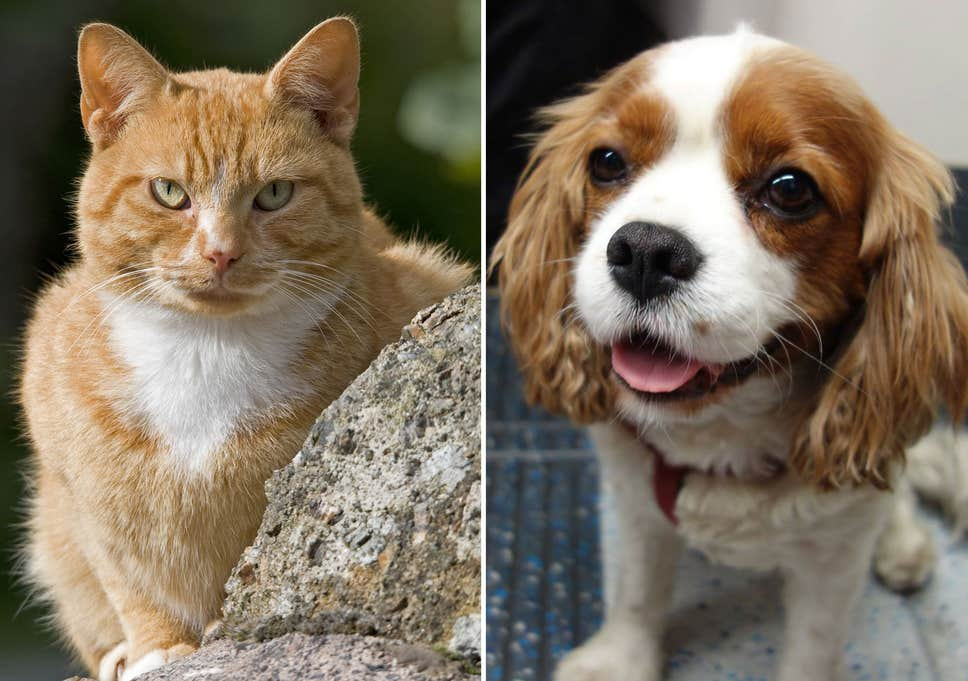

# Transfer Learning with Cats vs Dogs

A binary image classifier built with TensorFlow 2 / Keras that compares a CNN trained from
scratch against transfer learning from a pretrained MobileNetV2, using only 600 training images.


## Overview

This project shows what transfer learning brings when data is scarce. A benchmark CNN is trained
from scratch on 600 images of cats and dogs, then a MobileNetV2 pretrained on ImageNet is used as
a frozen feature extractor with a small new classifier head on top. Both models are trained under
the same conditions and compared on a held-out test set.

The transfer learning model reaches **98.67% accuracy on the 300 test images**, against 52.00% for
the CNN trained from scratch, while training only 41,025 parameters.

Everything lives in a single notebook:
[`tf2-transfer-learning-cats-dogs.ipynb`](tf2-transfer-learning-cats-dogs.ipynb)

## Dataset



A subset of the [Dogs vs Cats dataset](https://www.kaggle.com/c/dogs-vs-cats/data) (25,000 images
in the original, taken from the Asirra CAPTCHA):

|  |  |
|---|---|
| Training set | 600 images |
| Validation set | 300 images |
| Test set | 300 images |
| Image format | 160x160 RGB, pixel values 0-255 |
| Classes | Dog (`0`), Cat (`1`) |
| Task | binary image classification |

Preprocessing is minimal: pixel values are divided by 255 to scale them to `[0, 1]`.

> The image arrays (`data/images_*.npy`, about 370 MB combined) are not included in this
> repository. See [Getting started](#getting-started) below.

## Models

Both models are compiled with RMSprop (learning rate 0.001) and binary crossentropy, and trained
for up to 10 epochs with a batch size of 32 and `EarlyStopping(patience=2)`.

### Benchmark CNN (trained from scratch)

| Layer | Configuration | Output shape | Params |
|-------|---------------|--------------|--------|
| `Conv2D` x2 | 32 filters 3x3, `padding="same"`, ReLU | (160, 160, 32) | 10,144 |
| `MaxPooling2D` | 2x2 | (80, 80, 32) | 0 |
| `Conv2D` x2 | 64 filters 3x3, `padding="same"`, ReLU | (80, 80, 64) | 55,424 |
| `MaxPooling2D` | 2x2 | (40, 40, 64) | 0 |
| `Conv2D` x2 | 128 filters 3x3, `padding="same"`, ReLU | (40, 40, 128) | 221,440 |
| `MaxPooling2D` | 2x2 | (20, 20, 128) | 0 |
| `Flatten` | - | (51200,) | 0 |
| `Dense` | 128 units, ReLU | (128,) | 6,553,728 |
| `Dense` | 1 unit, sigmoid | (1,) | 129 |

**6,840,865 trainable parameters.**

### Transfer learning model

| Layer | Configuration | Params |
|-------|---------------|--------|
| MobileNetV2 (frozen) | pretrained on ImageNet, final classifier removed, 1,280 features out | 2,257,984 (non-trainable) |
| `Dense` | 32 units, ReLU | 40,992 |
| `Dropout` | 0.5 | 0 |
| `Dense` | 1 unit, sigmoid | 33 |

**41,025 trainable parameters** out of 2,299,009 in total (1.8%), about 165 times fewer than the
benchmark.

## Workflow

1. **Load and preprocess** — load the `.npy` splits and scale pixels to `[0, 1]`.
2. **Explore** — random sample of training images with their labels.
3. **Benchmark** — build, train and evaluate a CNN from scratch.
4. **Feature extractor** — load MobileNetV2 and remove its ImageNet classification layer.
5. **New head** — add `Dense(32)`, `Dropout(0.5)` and a sigmoid output with the Sequential API.
6. **Freeze and train** — freeze the pretrained weights and train only the new layers.
7. **Compare** — metrics table and confusion matrices of both models on the test set.

## Results

| Metric | Benchmark CNN | Transfer learning |
|--------|--------------:|------------------:|
| Trainable params | 6,840,865 | 41,025 |
| Train accuracy | 62.33% | 98.50% |
| Val accuracy | 50.00% | 94.33% |
| Test accuracy | 52.00% | **98.67%** |
| Test loss | 0.8835 | **0.0625** |

Train and validation values are from the last epoch of each run. The benchmark ran the full 10
epochs; the transfer learning model was stopped by `EarlyStopping` at epoch 7.

On the test set the benchmark classifies almost everything as a dog (147 of 150 dogs right, only 9
of 150 cats), while the transfer learning model makes just 4 mistakes in 300 images, 2 per class.

## Key takeaways

- **Too little data for a model from scratch.** With 600 images and 6.8 million parameters, the
  benchmark never learns: validation accuracy hovers around 50% (chance for two balanced classes)
  and validation loss stays near 0.69, the loss of a model that always answers 50/50.
- **Pretrained features do most of the work.** The transfer learning model already has 94.3%
  validation accuracy after its first epoch, since MobileNetV2's ImageNet filters are useful for
  telling cats from dogs without any retraining.
- **Freezing makes training cheap.** Only 1.8% of the parameters are trained, so epochs are faster
  and a few hundred images are enough to fit the new head.
- **It overfits quickly, though.** Validation loss bottoms out at epoch 5 while training loss keeps
  falling, and `EarlyStopping` ends training at epoch 7. Without `restore_best_weights`, the model
  keeps the epoch 7 weights, not the epoch 5 ones.

## Project structure

```
.
├── data/                                # Sample image and labels (image arrays not tracked)
├── models/                              # Pretrained MobileNetV2 (MobileNetV2.h5)
├── src/tf2_transfer_learning_cats_dogs/ # Package scaffold
├── tf2-transfer-learning-cats-dogs.ipynb # Main notebook
└── pyproject.toml                       # Dependencies (uv project)
```

## Getting started

The project is managed with [uv](https://docs.astral.sh/uv/) and requires Python 3.11+.

```bash
# Clone the repository
git clone https://github.com/ramirezgrosas/tf2-transfer-learning-cats-dogs.git
cd tf2-transfer-learning-cats-dogs

# Create the virtual environment and install the dependencies
uv sync
```

The three image arrays are not included in the repo (they weigh about 370 MB together). Get the
Dogs vs Cats subset used in this notebook (or an equivalent one, as 160x160 RGB `uint8` arrays)
and place it in `data/` next to the labels already tracked in the repo:

```
data/images_train.npy   # 600 images
data/images_valid.npy   # 300 images
data/images_test.npy    # 300 images
```

Then open the notebook in VS Code and select `.venv` as the kernel, or launch Jupyter directly:

```bash
uv run --with jupyter jupyter lab
```

Main dependencies: TensorFlow 2.21 (Keras 3.15), NumPy, pandas, matplotlib, seaborn and
scikit-learn.

## Possible improvements

- Use `restore_best_weights=True` in `EarlyStopping` to keep the best epoch instead of the last.
- Fine-tune the last layers of MobileNetV2 with a very small learning rate after training the head.
- Add data augmentation (flips, rotations, zoom) to get more out of the 600 training images.
- Use more of the 25,000 original images, which would also give the benchmark a fair chance.
- Inspect the four misclassified test images to see what the model still gets wrong.

## Author

**Diego Ramírez Rosas** — [ramirezgrosas](https://github.com/ramirezgrosas)
